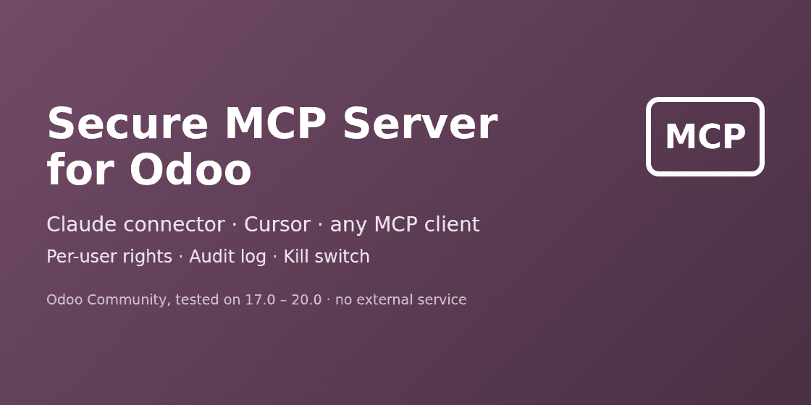
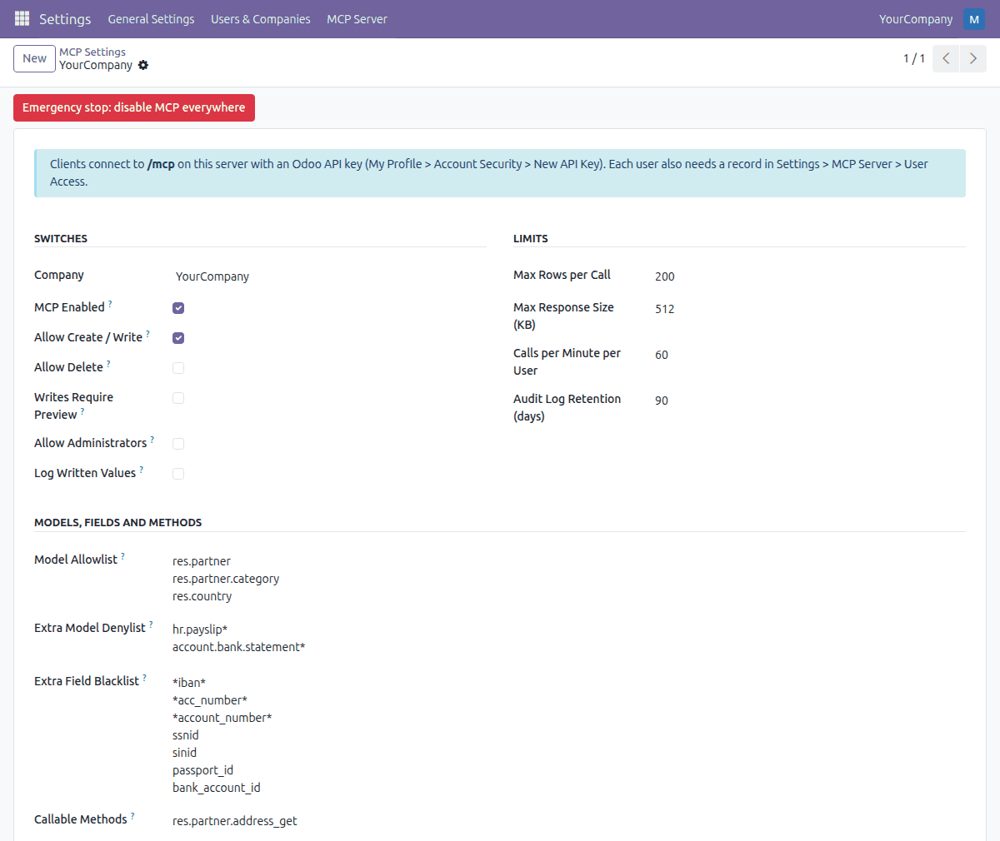
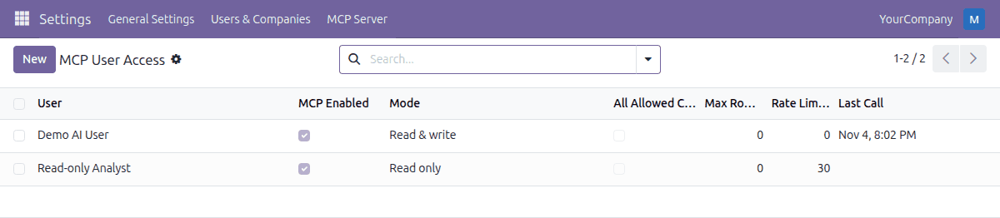
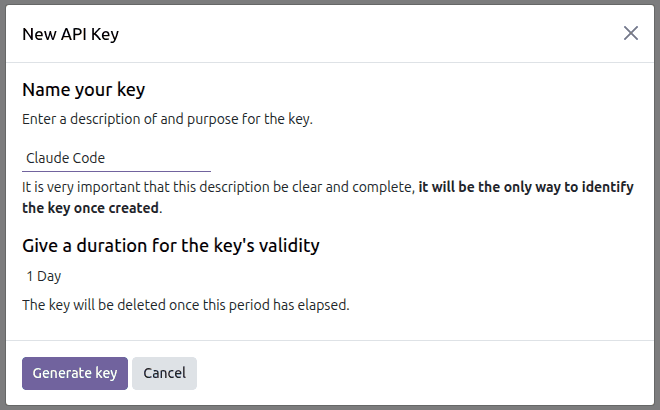
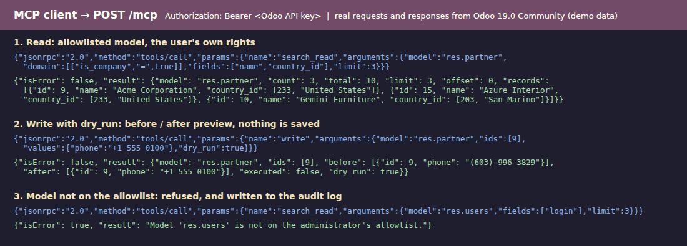
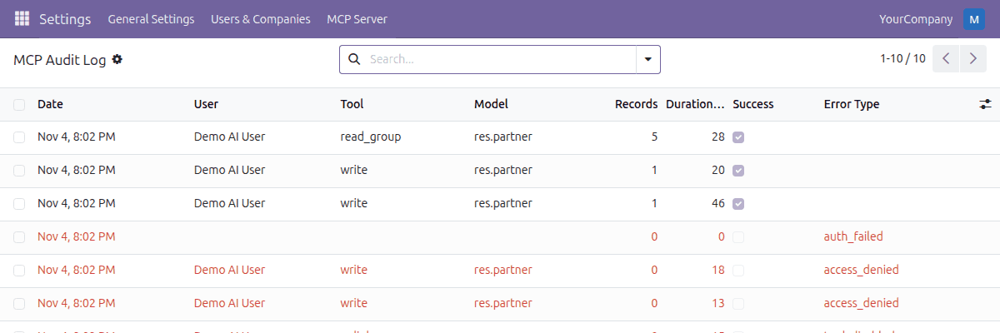
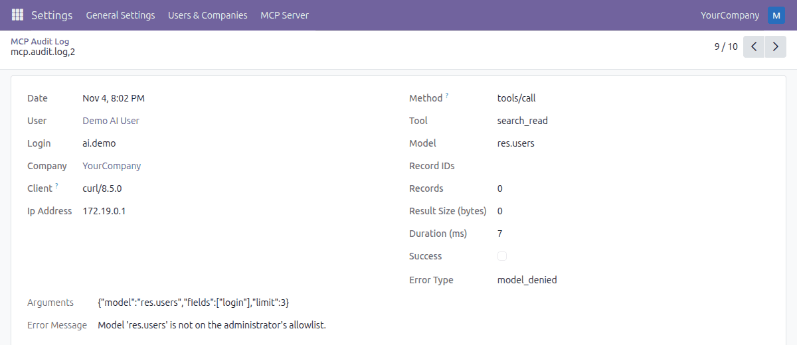

# Secure MCP Server for Odoo



**A Model Context Protocol (MCP) server inside Odoo: let Claude Code, Claude Desktop, Cursor and other MCP clients read and write Odoo as the logged-in user, never as more, with an audit log of every call.**

> **This repository contains documentation only.** The module source is distributed through the Odoo Apps Store under the Odoo Proprietary License v1.0 (OPL-1).

| | |
|---|---|
| Module technical name | `mcp_server_secure` |
| Vendor | Kevin Apps |
| Odoo versions | 17.0, 18.0, 19.0, 20.0 (tested on Community) |
| Price | €49 |
| License | OPL-1 (module), CC BY 4.0 (this documentation) |

## What it is

Secure MCP Server adds one endpoint, `/mcp`, to your Odoo. It speaks the Model Context Protocol (Streamable HTTP, JSON-RPC 2.0). An AI client authenticates with an Odoo API key, and every tool call runs as the user who owns that key: access rights, record rules, field groups and multi-company rules apply exactly as in the Odoo interface.

There is no service account, no `sudo` for data, no raw SQL and no code execution. The module calls no external service. It depends on `base` only.

## Who it is for

- Odoo Community users (17.0 to 19.0, and 20.0) who want to connect an AI client to their ERP.
- Teams that need to know afterwards what the AI read or changed, and want a way to switch it off quickly.
- Administrators who want to give an AI agent a dedicated user with the minimum rights, in read-only mode to start.

## Features

- **Per-user API keys.** Uses Odoo's own API keys, sent only in the `Authorization: Bearer` header.
- **Runs as that user.** ACLs, record rules, field groups and multi-company rules apply. By default only the user's current company; optionally all their companies that have MCP enabled.
- **Opt-in per user, read-only mode.** Each user gets a *Read only* or *Read & write* mode. Read-only users do not even see the write tools.
- **Model allowlist and denylist.** Wildcards supported. Sensitive models (secrets, security rules, scheduled actions, mail servers, API keys, bank accounts, views, actions, menus and every other `ir.*` model except attachments, filters, exports and external IDs, read only) are always blocked.
- **Field blacklist.** Passwords, tokens, secrets, API keys and file content are never returned, searched, sorted, grouped or written. A default list of patterns (IBAN, account numbers, national ids) is preloaded; you can add your own.
- **Kill switch.** MCP is off per company until you enable it; one button disables it for every company and user.
- **Rate and row limits.** Row cap, response size cap and a per-user, per-minute rate limit. Request bodies are limited to 1 MiB.
- **Dry-run writes.** `create` and `write` support `dry_run` (before / after preview, nothing saved). Optional "Writes require preview" setting issues a single-use token (valid 10 minutes) bound to the user, tool and exact arguments.
- **Delete off by default.** `unlink` must be switched on per company. While it is off, x2many commands that delete lines are refused.
- **Audit log.** Every tool call, including failed and refused ones: user, client, tool, model, record ids, arguments, result size, duration, success or error. Read only for everybody; only the retention job purges rows.
- **Clear errors.** Access errors come back as "Permission denied" tool results, not stack traces.

## Screenshots

Taken on a throwaway Odoo 19.0 Community database with demo data.

**Settings per company: kill switch, limits, model allowlist and denylist, field blacklist**



**User access: Read only or Read & write per user**



**Each user creates an Odoo API key for the AI client**



**What the AI client sees: a read, a dry-run write preview and a refused call**



**Audit log: successful and refused calls**



**Audit log entry: user, tool, model, arguments, duration and error**



## Setup

1. Install the module from the Odoo Apps Store.
2. Open **Settings > MCP Server > Settings**, tick **MCP Enabled** for your company and save.
3. Open **MCP Server > User Access** and add the users that may use MCP (*Read only* to start).
4. Each of these users creates an API key and pastes it into the client below.
   - Odoo 19.0 and 20.0: **My Preferences > Security > Add API Key**
   - Odoo 17.0 and 18.0: **My Profile > Account Security > New API Key**
5. Use HTTPS in production.

Replace `YOUR-ODOO` and `YOUR_API_KEY` in the examples.

### Claude Code

```bash
claude mcp add --transport http odoo https://YOUR-ODOO/mcp \
  --header "Authorization: Bearer YOUR_API_KEY"
```

### Cursor

In `~/.cursor/mcp.json` or `.cursor/mcp.json`:

```json
{
  "mcpServers": {
    "odoo": {
      "url": "https://YOUR-ODOO/mcp",
      "headers": { "Authorization": "Bearer YOUR_API_KEY" }
    }
  }
}
```

### Claude Desktop

Claude Desktop launches local servers, so it uses the small stdio bridge shipped inside the module (`mcp_server_secure/tools/mcp_stdio_bridge.py`, Python 3, standard library only). In `claude_desktop_config.json`:

```json
{
  "mcpServers": {
    "odoo": {
      "command": "python3",
      "args": ["/path/to/mcp_stdio_bridge.py"],
      "env": {
        "ODOO_MCP_URL": "https://YOUR-ODOO/mcp",
        "ODOO_API_KEY": "YOUR_API_KEY"
      }
    }
  }
}
```

The same bridge works for any client that only supports stdio. If your Odoo has several databases, set `--db-filter` (or use a sub-domain per database) so that `/mcp` resolves to one.

Behind a reverse proxy, forward the `Authorization` header and use HTTPS. Start Odoo with `--proxy-mode` so audit entries record the real IP address.

## MCP tools exposed

| Tool | What it does | Availability |
|---|---|---|
| `list_models` | Discover the models the user can see | always |
| `describe_model` | Fields, types and selections of a model | always |
| `search_read` | Domain, fields, order, limit and offset, with row and size caps | always |
| `read` | Read records by id | always |
| `read_group` | Group and aggregate (sum, avg, min, max, count), date grouping | always |
| `create` | Create a record (supports `dry_run`) | *Read & write* users, company write switch on |
| `write` | Update records (supports `dry_run`) | *Read & write* users, company write switch on |
| `unlink` | Delete records | off by default; enable per company ("Allow Delete") |
| `call_method` | Call a public business method, e.g. `sale.order.action_confirm` | only methods you whitelist in settings; private methods never |

Protocol methods: `initialize`, `ping`, `tools/list`, `tools/call`. No resources, prompts, SSE or sessions.

## Security model

- **Authentication:** Odoo API keys (hashed in the database, revocable by the user; expiry date on Odoo 18.0 and later). Keys are accepted only in the `Authorization: Bearer` header, never in the URL.
- **Authorization:** each call runs in the environment of the authenticated user. Models are checked against the ACL, records against record rules, fields against their groups.
- **Administrators are blocked by default.** Give the AI a dedicated user, not your admin.
- **Query hardening:** domains are validated field by field and for structure, so a blacklisted field cannot be probed through a filter, sort, grouping or related-record name.
- **Writes:** read-only, computed, binary and system fields are rejected. Models that can escalate privileges or run code (users, groups, company settings, mail templates, attachments) are read only even when the user's ACL would allow writing. Every write runs in a savepoint.
- **Browsers:** requests with an `Origin` header are accepted only for the origin of `web.base.url` or an origin you list. No CORS is implemented; desktop and CLI clients send no Origin.
- **Data flow:** the module sends nothing anywhere. What an AI client reads is processed by that client's provider, so give it only users and models you are happy to share.
- **Prompt injection** is a property of AI clients, not of this module. Keep users read-only unless writes are needed and consider "Writes require preview".

The module cannot protect data from a user who is allowed to see it. Use dedicated users with the minimum rights.

## Limitations

- **API keys only, no OAuth.** Clients that require OAuth sign-in, such as claude.ai custom connectors, cannot connect. Use Claude Code, Cursor or the stdio bridge.
- ChatGPT connectors have **not been tested**. Tested: Claude Code, Cursor and the stdio bridge.
- Odoo **Enterprise is not tested**; tested on the official Community images 17.0 to 20.0.
- No resources, prompts or streaming.
- `call_method` cannot be previewed with `dry_run`.
- A `dry_run` runs the write in a rolled-back savepoint; database sequence numbers, file store writes and external checks (for example VAT number validation) are not undone.
- Multi-database servers need `--db-filter` or sub-domains so that `/mcp` resolves to one database.

### Odoo 20's own MCP server

According to Odoo's documentation, Odoo 20 ships its own MCP server as part of its AI features (OAuth or API key). If you run Odoo 20 Enterprise and it covers your needs, use it. This module is for Odoo Community, Odoo 17.0 to 19.0, and teams that need an audit log with retention, rate limit, kill switch, allowlist and dry-run. Odoo 20's server has OAuth 2.1 sign-in and tools built from AI server actions, which this module does not.

## FAQ

**Does it work with Claude Code, Claude Desktop and Cursor?**
Claude Code and Cursor connect directly to `/mcp` with the API key. Claude Desktop uses the stdio bridge. Any other client that supports MCP Streamable HTTP with a custom `Authorization` header, or stdio, can use it too.

**Does it work with claude.ai custom connectors or ChatGPT connectors?**
Only if the client lets you send an `Authorization: Bearer` header (or you use the stdio bridge). This version has no OAuth, so connector screens that require OAuth sign-in cannot connect. ChatGPT has not been tested.

**Can the AI see more than the user it connects as?**
No. Calls run with that user's Odoo rights, record rules and field groups.

**Can it change or delete data?**
Only for users you set to *Read & write*, only on allowed models, and delete is off until you enable it per company. Use `dry_run` or "Writes require preview" to check changes first.

**Is data sent to a third party?**
The module sends nothing anywhere and calls no external service. What an AI client reads is processed by that client's provider.

**Does it work on Odoo Community? On Enterprise?**
It depends on `base` only and is tested on Community 17.0 to 20.0. Enterprise has not been tested.

**How do I stop it?**
Press **Emergency stop: disable MCP everywhere** in the settings, or untick *MCP Enabled* for a company or a user.

## Get it

€49 on the Odoo Apps Store:

- [Odoo 17.0](https://apps.odoo.com/apps/modules/17.0/mcp_server_secure)
- [Odoo 18.0](https://apps.odoo.com/apps/modules/18.0/mcp_server_secure)
- [Odoo 19.0](https://apps.odoo.com/apps/modules/19.0/mcp_server_secure)
- [Odoo 20.0](https://apps.odoo.com/apps/modules/20.0/mcp_server_secure)

## Support

Use the support contact on the module's Odoo Apps Store page.

## License

The module is licensed under the Odoo Proprietary License v1.0 (OPL-1) and is not part of this repository. Documentation and images in this repository are licensed under [CC BY 4.0](LICENSE).
